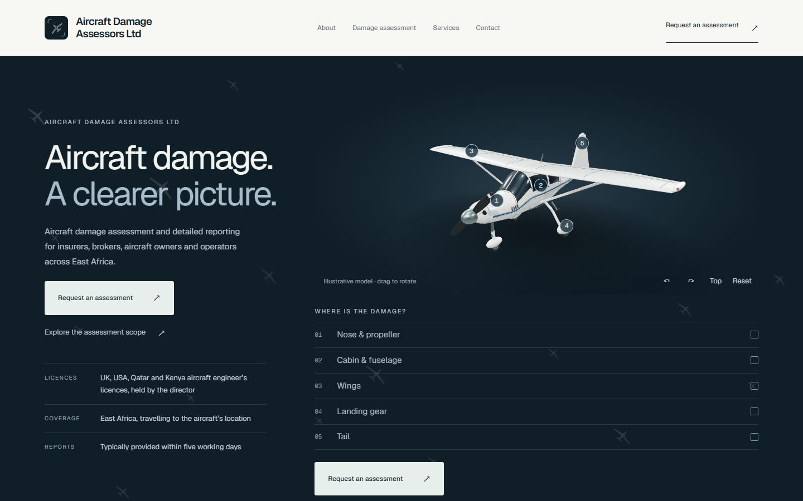

# Aircraft Damage Assessors Ltd

Production website built for a real client: an aircraft damage assessment business serving aircraft insurers, brokers, owners and operators in East Africa.



- **Live site:** [aircraftdamageassessors.com](https://www.aircraftdamageassessors.com)
- **Client:** Aircraft Damage Assessors Ltd

## What I delivered

Design, build and deployment of the company's public website, from the first brief through to the live domain. Every company fact on the site was confirmed by the client before it was published.

- **Interactive aircraft model:** a Three.js light aircraft on the homepage that visitors can rotate and use to mark where the damage is (nose and propeller, cabin, wings, landing gear, tail) before requesting an assessment.
- **Service architecture:** service and company content lives in central data files (`src/data/`), so pages share one source of truth, and a copy-check script blocks wording the client has ruled out.
- **Enquiry form:** client-side and server-side validation, photo/PDF attachments downscaled in the browser, spam protection, email delivery with an automatic confirmation, and a no-JavaScript fallback. See [docs/ENQUIRY-SETUP.md](docs/ENQUIRY-SETUP.md).
- **Responsive and accessible UI:** designed and tested at 1440, 1024, 768 and 390px, with keyboard navigation, visible focus states and reduced-motion support.
- **SEO and deployment:** per-page metadata, Open Graph images, sitemap and robots, deployed on Vercel.

## Tech stack

Next.js 16 (App Router) · React 19 · TypeScript · Tailwind CSS 4 · Three.js · Vercel

## Running locally

```bash
npm install
npm run dev     # http://localhost:3000
npm run lint    # ESLint plus the copy check
npm run build
```

Browser checks (need a running site and local Chrome): `npm run test:site`, `npm run test:aircraft`, `npm run test:enquiry`.
